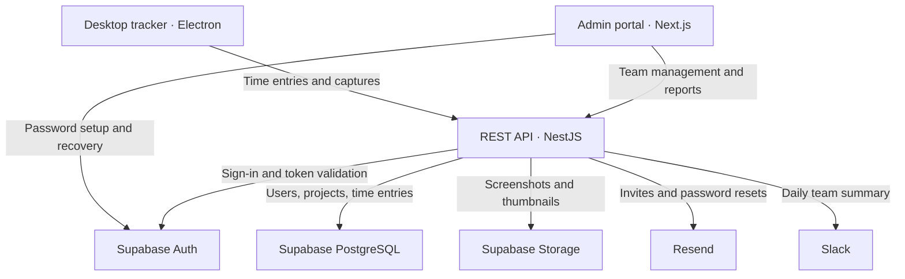
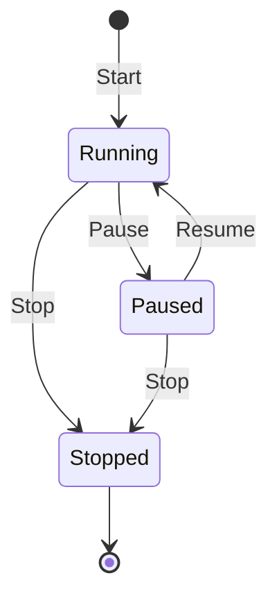

# ClockWork

### Time tracking for teams, on your infrastructure.

ClockWork brings desktop time tracking, screenshot review, and team reporting into one self-hosted workspace. Team members track time against projects; managers review sessions, work diaries, and reports from a web dashboard.

Built for agencies, remote teams, and internal operations that want to run and customize their own tracking system.

[Get started](#local-setup) · [Employee guide](docs/EMPLOYEE_GUIDE.md) · [Admin guide](docs/ADMIN_GUIDE.md) · [Deployment](#deployment) · [Security](SECURITY.md) · [Releases](https://github.com/mohsinjavaid786/ClockWork/releases) · [Changelog](CHANGELOG.md)

**Before deploying:** apply migration `009_api_only_access.sql` and follow the [security deployment requirements](SECURITY.md#deployment-requirements). Source updates do not automatically change hosted Supabase policies.

## What you can do

| Capability | How it helps |
|---|---|
| **Track project time** | Start, pause, resume, and stop a desktop timer with a project and work description. Paused time is excluded from tracked duration. |
| **See team activity** | Review tracked hours, sessions, screenshots, and who is tracking now. Explore trends by date range. |
| **Review work diaries** | Open a team member's profile to inspect daily sessions, screenshot filmstrips, and activity details. |
| **Capture multiple displays** | Capture each connected display at a configurable interval, with lightweight thumbnails for browsing. |
| **Inspect sessions** | Open timesheet details and zoom or pan through screenshots alongside per-minute keyboard and mouse counts and foreground-window information. |
| **Manage people and projects** | Invite members, manage roles and account status, and create or archive projects. |
| **Share reports** | Export date-range CSVs and printable HTML reports. Configure a daily Slack summary. |
| **Make it your own** | Configure the company name, screenshot interval, timezone, and light or dark dashboard appearance. |

## A typical workday

1. An admin creates projects and invites team members.
2. A member installs the desktop app, signs in, selects a project, and starts tracking.
3. ClockWork records the session and periodically uploads screenshots and activity summaries.
4. The member pauses for a break, resumes, and stops when finished.
5. The admin reviews the work diary or timesheet and exports a report.

The desktop app includes a tray indicator, local session persistence, reconciliation with an existing server session on launch, and GitHub Releases update integration.

## How it works



The API exposes business endpoints under `/api/v1`, with interactive Swagger documentation at `/api/docs`. Screenshot files use a private bucket; the portal receives time-limited signed URLs.

### Timer lifecycle



A database constraint allows at most one open entry—running or paused—per user. Apply migration `008_one_open_entry.sql` to enable that constraint.

## Local setup

### 1. Install prerequisites

- **Node.js 22 or newer**, as declared in the root package.
- **pnpm 11.4.0**, pinned by the repository's `packageManager` field.
- A **Supabase project** for PostgreSQL, authentication, and file storage.
- **Resend credentials** to deliver invitation and password-reset emails.
- macOS or Windows for the desktop workflow. The current packaging configuration targets **macOS Apple Silicon (arm64)** and **Windows x64**.

Install the pinned package manager if needed:

```bash
npm install -g pnpm@11.4.0
```

### 2. Clone and prepare

```bash
git clone https://github.com/mohsinjavaid786/ClockWork.git
cd ClockWork
pnpm install --frozen-lockfile

cp apps/api/.env.example apps/api/.env
cp apps/admin/.env.example apps/admin/.env.local

pnpm --filter @clockwork/shared build
```

### 3. Configure the apps

Edit the copied files using the values from your Supabase project:

| File | Variable | Value or purpose |
|---|---|---|
| `apps/api/.env` | `SUPABASE_URL` | Your Supabase project URL. |
| `apps/api/.env` | `SUPABASE_SERVICE_ROLE_KEY` | Server-side service-role key. Keep it out of client apps and Git. |
| `apps/api/.env` | `PORT` | `3001` for local development. |
| `apps/api/.env` | `ADMIN_URL` | `http://localhost:3000`; used for CORS and email redirects. |
| `apps/api/.env` | `RESEND_API_KEY`, `RESEND_FROM` | Email delivery credentials and sender. Remove the placeholder API key if testing without email. |
| `apps/api/.env` | `COMPANY_NAME` | Company name used in emails. |
| `apps/admin/.env.local` | `NEXT_PUBLIC_API_URL` | `http://localhost:3001` — the API origin, without `/api/v1`. |
| `apps/admin/.env.local` | `NEXT_PUBLIC_SUPABASE_URL` | Your Supabase project URL, used by password setup and recovery. |
| `apps/admin/.env.local` | `NEXT_PUBLIC_SUPABASE_ANON_KEY` | Supabase public anon key for those browser flows. |

In Supabase Authentication, enable email sign-in and allow `http://localhost:3000/reset-password` as a redirect URL. Add your deployed portal's equivalent URL when deploying.

Without a Resend API key, email sends are suppressed and logged. Resend's test sender only delivers to your own Resend account email; configure a verified sender domain for team invitations.

The desktop reads `API_URL` from its process environment. The local default is `http://localhost:3001`; creating a desktop `.env` file alone does not configure it.

### 4. Initialize the database

For a fresh Supabase project, open **SQL Editor** and run the files in [supabase/migrations](supabase/migrations) in filename order:

| Order | Migration |
|---|---|
| 1 | `001_initial.sql` |
| 2 | `002_storage.sql` |
| 3 | `003_multi_screen.sql` |
| 4 | `004_activity_detail.sql` |
| 5 | `005_pause_tracking.sql` |
| 6 | `006_installers_bucket.sql` |
| 7 | `007_screenshot_thumbnails.sql` |
| 8 | `008_one_open_entry.sql` |

For an existing installation, apply only migrations that have not already run. Keep the `screenshots` bucket private. The separate `installers` bucket is public for desktop downloads.

### 5. Create the first admin

In **Supabase → Authentication → Users**, add your user with an email and password and confirm the email. Then create the matching application profile in SQL Editor, replacing the example email and name:

```sql
insert into public.users (id, name, email, role, is_active, timezone)
select id, 'Your Name', email, 'admin', true, 'UTC'
from auth.users
where email = 'you@example.com'
on conflict (id) do update
set role = 'admin', is_active = true;
```

Confirm that the user appears in `public.users` with the same ID as `auth.users`. Login requires both records; changing a role with `UPDATE` alone does not create a missing profile.

### 6. Start the API, portal, and desktop

Run each app in a **separate terminal**, starting from the repository root.

**API:** the current API does not automatically load `.env`. Use Node's environment-file loader so the watch process inherits the configured values:

```bash
pnpm --filter api exec node --env-file=.env node_modules/@nestjs/cli/bin/nest.js start --watch
```

If you already export the API variables in your shell or hosting environment, use `pnpm dev:api`.

**Admin portal:**

```bash
pnpm dev:admin
```

**Desktop:** build once before launching; rebuild after changes to the main or preload code.

```bash
pnpm build:desktop
API_URL=http://localhost:3001 pnpm dev:desktop
```

The inline `API_URL=...` syntax is for macOS/Linux shells. In PowerShell, set `$env:API_URL = "http://localhost:3001"` before running `pnpm dev:desktop`.

| Service | Local address |
|---|---|
| Admin portal | [http://localhost:3000](http://localhost:3000) |
| API health | [http://localhost:3001/api/v1/health](http://localhost:3001/api/v1/health) |
| API documentation | [http://localhost:3001/api/docs](http://localhost:3001/api/docs) |

### 7. Try your first session

Sign in to the portal, create a project, then sign in to the desktop app with an active team account. Start a timer, pause and resume it, and stop. Check the resulting entry in **Timesheets** and the member's **Work diary** tab.

On macOS, grant **Screen Recording** and **Accessibility** permissions when prompted. Screenshot capture and activity tracking depend on OS permissions and native module availability.

## Deployment

| Component | Deployment path |
|---|---|
| **API** | Use [railway.json](railway.json) and [apps/api/Dockerfile](apps/api/Dockerfile). Keep the Docker build context at the repository root so workspace dependencies are available. Configure API variables on the host. |
| **Admin portal** | Deploy to Vercel with `apps/admin` as the project root. Set all three `NEXT_PUBLIC_*` variables before building. |
| **Database and storage** | Apply migrations to your Supabase project and verify bucket access settings. |
| **Desktop installers** | Set the repository Actions variable `API_URL` to the deployed API origin. The [release workflow](.github/workflows/release.yml) builds and publishes installers when a `v*.*.*` tag is pushed. |
| **Invite download links** | The release workflow can publish installers to Supabase when its required secrets are configured. Alternatively, set `DOWNLOAD_URL_MACOS` and `DOWNLOAD_URL_WINDOWS` on the API. |
| **Slack summaries** | Configure the webhook in portal settings. The current scheduled summary runs at **09:00 UTC**. |

Use HTTPS for the deployed API and portal. Set `ADMIN_URL` to the deployed portal origin and allow its password-reset redirect in Supabase.

See the [deployment guide](docs/DEPLOYMENT.md) for host configuration, branch conventions, and signing details. The current builder configuration produces **arm64 macOS builds**, even though some older release instructions describe universal builds.

## Data and access

ClockWork captures **unblurred screenshots of connected displays**, input-event counts, and foreground application/window information. Keyboard activity records counts rather than the text typed. Explain the capture behavior to team members before enabling it.

- **API access:** Supabase token validation, active-account checks, and admin/member role guards protect application routes.
- **Storage:** screenshot access uses signed URLs. Keep the service-role key server-side; the API's database client uses it and bypasses Supabase RLS.
- **Local credentials:** desktop authentication and timer state are stored in a plain JSON file in the user's app-data directory, rather than an OS keychain.
- **Desktop isolation:** the renderer uses context isolation and disables Node integration; the current preload runs with the Electron sandbox disabled.
- **Distribution:** the current macOS configuration uses ad-hoc signing rather than notarization. Test installation, permissions, and updates on your target devices before rollout.

## Technology and project map

| Component | Stack | Source and reference |
|---|---|---|
| Admin portal | Next.js 15, React 19, Tailwind CSS, Recharts | [apps/admin](apps/admin) · [README](apps/admin/README.md) |
| REST API | NestJS 11, TypeScript, Supabase JS | [apps/api](apps/api) · [README](apps/api/README.md) |
| Desktop app | Electron 30, React 19, Vite, native activity modules | [apps/desktop](apps/desktop) · [README](apps/desktop/README.md) |
| Shared contracts | TypeScript domain types and IPC channels | [packages/shared](packages/shared) · [README](packages/shared/README.md) |
| Persistence | Supabase PostgreSQL, Auth, Storage | [Migrations](supabase/migrations) |
| Delivery | GitHub Actions, Docker, Railway, Vercel | [Workflows](.github/workflows) · [Deployment guide](docs/DEPLOYMENT.md) |

### Build commands

Build shared contracts before the applications:

```bash
pnpm --filter @clockwork/shared build
pnpm build:api
pnpm build:admin
pnpm build:desktop
```

For desktop installers, use the release workflow, which applies the dependency-hoisting setup required by electron-builder. Packaging configuration lives in [electron-builder.config.js](apps/desktop/electron-builder.config.js).

## Troubleshooting

| Symptom | Check |
|---|---|
| API says Supabase variables are missing | Start it with the environment-file command above or export the variables before `pnpm dev:api`. |
| Login says "User profile not found" | Create the `public.users` row using the same ID as the Supabase Auth user. |
| Invitation or password-reset email never arrives | Check Resend credentials, the sender domain, and API email logs. |
| Password setup or recovery fails | Check the portal's public Supabase variables and Supabase redirect allowlist. |
| Browser requests fail or report CORS errors | Check `NEXT_PUBLIC_API_URL` and the API's `ADMIN_URL`; restart or rebuild after changing environment values. |
| Desktop will not launch after cloning | Build shared contracts and desktop output before `pnpm dev:desktop`. |
| Screenshots are missing or activity stays at zero | Check OS permissions and native module loading. Unsupported or unavailable activity modules can return zero counts. |
| API reports missing columns or duplicate sessions | Verify all migrations through `008_one_open_entry.sql` have been applied. |
| Packaged desktop connects to localhost | Set the Actions `API_URL` variable and rebuild the installer. |

## Documentation

- [Employee guide](docs/EMPLOYEE_GUIDE.md): installation, tracking, screenshots, and common questions.
- [Admin guide](docs/ADMIN_GUIDE.md): dashboard, team management, work diaries, timesheets, and reports.
- [Deployment guide](docs/DEPLOYMENT.md): hosting, environment configuration, desktop distribution, and CI/CD.
- [Changelog](CHANGELOG.md): release history.
- [Issues](https://github.com/mohsinjavaid786/ClockWork/issues): bug reports and improvement requests.

## Maintainer

Maintained by [**Mohsin Javaid**](https://github.com/mohsinjavaid786), Partner & Head of Product Delivery at [Turing Technologies](https://www.turingtechnologies.org/), based in Islamabad, Pakistan.

[More personal projects](https://github.com/mohsinjavaid786#featured-personal-projects) · [LinkedIn](https://www.linkedin.com/in/mohsinjavaid47/)
